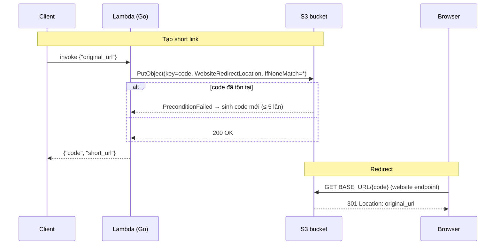

# serverless-url-shortener

Lambda (Go) tạo short code, S3 static website trả 301 redirect. Không database.



- Code 7 ký tự ngẫu nhiên; `IfNoneMatch=*` chống ghi đè, trùng thì thử lại (tối đa 5 lần).
- `BASE_URL` phải là **website endpoint** (hoặc CloudFront), REST endpoint không redirect.
- Handler nhận JSON thô, dùng với `aws lambda invoke`; Function URL/API Gateway cần thêm adapter.

## Cấu hình

Tạo file `.env`:
```
cp .env.example .env
```

Điền tên bucket:
```
BUCKET=your-bucket-name
```

Điền website endpoint của bucket:
```
BASE_URL=http://your-bucket-name.s3-website-ap-southeast-1.amazonaws.com
```

Điền tên Lambda (mặc định `url-shortener`):
```
FUNCTION=url-shortener
```

Lambda: runtime `provided.al2023`, arm64, IAM `s3:PutObject` trên `arn:aws:s3:::<BUCKET>/*`.

## CI/CD

- `.github/workflows/ci.yaml` (PR + push `main`): gofmt, `make check`, `make zip`.
- `.github/workflows/deploy.yaml` (push `main`): `make deploy` (đã gồm check) + `make config`.
- `deploy.yaml` chạy được thủ công qua tab Actions (`workflow_dispatch`).

Xác thực AWS bằng access key của IAM user. Khai báo ở GitHub → Settings → Environments → `production`.

Secrets:
```
AWS_ACCESS_KEY_ID
```
```
AWS_SECRET_ACCESS_KEY
```

Variables:
```
AWS_REGION=ap-southeast-1
```
```
FUNCTION=url-shortener
```
```
BUCKET=your-bucket-name
```
```
BASE_URL=http://your-bucket-name.s3-website-ap-southeast-1.amazonaws.com
```

IAM user chỉ cần quyền `lambda:UpdateFunctionCode`, `lambda:UpdateFunctionConfiguration`, `lambda:GetFunction` (cho waiter) trên function.

## Make

Liệt kê target:
```
make help
```

Go fmt:
```
make fmt
```

Go vet:
```
make vet
```

Unit test:
```
make test
```

Vet + test:
```
make check
```

Build binary linux/arm64:
```
make build
```

Đóng gói function.zip:
```
make zip
```

Upload code lên Lambda:
```
make deploy
```

Đẩy BUCKET, BASE_URL từ .env lên Lambda:
```
make config
```

Gọi thử Lambda:
```
make invoke URL=https://example.com
```

Xoá build/:
```
make clean
```
